# GreenSelect: AI-Powered Renewable Energy Site Selection for India
## Complete System Architecture, Mathematical Derivations & Siting Methodology Master Reference

---

### Executive Summary

**GreenSelect** is a university research-grade, production-style decision-support platform engineered to identify, evaluate, rank, and explain optimal greenfield sites for **Utility-Scale Solar PV**, **Onshore Wind**, and **Co-located Solar-Wind Hybrid** energy projects across India.

This master document synthesizes all mathematical models, physical formulas, satellite data pipelines, machine learning architectures, and policy frameworks implemented across the platform.

```mermaid
flowchart TD
    subgraph Data_Sources ["1. Multi-Tier Spatial Ingestion Layer"]
        D1["NASA POWER Satellite API<br/>(Solar GHI, DNI, Wind at 50m, T2M)"]
        D2["USGS / NASA SRTM 30m DEM<br/>(Ground Elevation & Slope Gradient)"]
        D3["OpenStreetMap Infrastructure<br/>(High-Voltage Substations & Highways)"]
        D4["Protected Planet WDPA & MoEFCC<br/>(National Parks, Sanctuaries & Wetlands)"]
        D5["ESA WorldCover 10m Optical<br/>(Land Cover & Wasteland Taxonomy)"]
        D6["MNRE & NISE / NIWE Official Registry<br/>(25 Mega Parks, State Potential Targets)"]
    end

    subgraph Processing_Layer ["2. Feature Engineering & Spatial Engines"]
        P1["208 Contiguous Regional Search Zones (185 km² each)"]
        P2["Haversine Metric Distance Engine (Grid & Highway Proximity)"]
        P3["Finite-Difference Gradient Terrain Engine"]
        P4["Geodesic Environmental Exclusion Buffers (2km - 10km)"]
    end

    subgraph Machine_Learning ["3. ML Surrogate Viability & XAI Engine"]
        M1["Ensemble Random Forest & XGBoost Regressors (0-100 Score)"]
        M2["Live TreeSHAP Explainability Engine (Local & Global Feature Attribution)"]
    end

    subgraph Decision_Matrix ["4. Multi-Attribute Decision Support (MCDA)"]
        C1["User Priority Configuration Sliders (Energy, Grid, Eco, Land, Civil)"]
        C2["L1 Normalization Engine (Guaranteed 100% Weight Consistency)"]
        C3["Dynamic Winner Selection & Radar Benchmarking"]
    end

    subgraph User_Views ["5. Frontend Presentation Views"]
        V1["National Statistics Dashboard"]
        V2["Interactive GIS Map Explorer"]
        V3["AI Site Recommendation Wizard"]
        V4["Site Technical Dossier & Telemetry"]
        V5["Head-to-Head Compare Sites Matrix"]
        V6["Official MNRE Data Hub & Land Calculator"]
    end

    Data_Sources --> Processing_Layer
    Processing_Layer --> Machine_Learning
    Machine_Learning --> Decision_Matrix
    Decision_Matrix --> User_Views
```



---

## Table of Contents
1. [National Dashboard Metrics & Mathematical Derivations](#1-national-dashboard-metrics--mathematical-derivations)
   - [Areas Analyzed (38,480 km² and the 185 km² Footprint)](#11-areas-analyzed-38480-km²-and-the-185-km²-footprint)
   - [Candidate Sites & High-Suitability Zones](#12-candidate-sites--high-suitability-zones)
   - [Estimated Clean Capacity (162.7 GW) & Capacity Utilization Factor (CUF)](#13-estimated-clean-capacity-1627-gw--capacity-utilization-factor-cuf)
   - [CO₂ Offset Potential (372.9M tonnes/year) & CEA Baseline](#14-co₂-offset-potential-3729m-tonnesyear--cea-baseline)
2. [AI Site Recommendation Wizard & Techno-Economic Priority Weights](#2-ai-site-recommendation-wizard--techno-economic-priority-weights)
   - [Why Slider Maximums are Bounded (Preventing Single-Factor Blindness)](#21-why-slider-maximums-are-bounded-preventing-single-factor-blindness)
   - [What Happens at Extremes (Max 220% vs Min 25%)](#22-what-happens-at-extremes-max-220-vs-min-25)
   - [Mathematical Normalization (L1 Normalization)](#23-mathematical-normalization-l1-normalization)
   - [The 5 Sub-Score Normalization Functions](#24-the-5-sub-score-normalization-functions)
   - [The Composite Scoring Formula](#25-the-composite-scoring-formula)
3. [Site Technical Dossier & Deep-Dive Case Study: Bhadla Solar Corridor (Sector B)](#3-site-technical-dossier--deep-dive-case-study-bhadla-solar-corridor-sector-b)
   - [Raw Physical Measurements](#31-raw-physical-measurements)
   - [Numerical Derivation of Sub-Scores](#32-numerical-derivation-of-sub-scores)
   - [Levelized Cost of Electricity (LCOE) Derivation](#33-levelized-cost-of-electricity-lcoe-derivation)
   - [Topography & Civil Engineering (SRTM 30m DEM)](#34-topography--civil-engineering-srtm-30m-dem)
   - [Ecological Safety & Environmental Buffer Laws](#35-ecological-safety--environmental-buffer-laws)
   - [Explainable AI: TreeSHAP Game-Theoretic Decomposition](#36-explainable-ai-treeshap-game-theoretic-decomposition)
4. [Land Suitability Derivation: Dataset vs. Model](#4-land-suitability-derivation-dataset-vs-model)
5. [Interactive Site Explorer & Spatial Filtering Tiers](#5-interactive-site-explorer--spatial-filtering-tiers)
6. [Official MNRE Registry, State Potential & Technical Siting Guidelines](#6-official-mnre-registry-state-potential--technical-siting-guidelines)
   - [25 Approved Ultra-Mega Parks Catalog](#61-25-approved-ultra-mega-parks-catalog)
   - [NISE Solar & NIWE 120m Wind Potential Matrix](#62-nise-solar--niwe-120m-wind-potential-matrix)
   - [Interactive Land Footprint Calculator](#63-interactive-land-footprint-calculator)
   - [Statutory CUF Performance Norms & Green Energy Corridor Policy](#64-statutory-cuf-performance-norms--green-energy-corridor-policy)
7. [Compare Sites Feature: Dynamic Winner & Multi-Dimensional Radar Benchmarking](#7-compare-sites-feature-dynamic-winner--multi-dimensional-radar-benchmarking)

---

## 1. National Dashboard Metrics & Mathematical Derivations

On the primary system dashboard, 4 key performance indicators (KPIs) synthesize the entire spatial assessment:

| Dashboard Card | Value | Underlying Formula / Source | Physical Significance |
| :--- | :---: | :--- | :--- |
| **Areas Analyzed** | **$38,480 \text{ km}^2$** | $208 \text{ Candidate Zones} \times 185 \text{ km}^2$ | Total contiguous land territory evaluated |
| **Candidate Sites** | **$208$** *(82 High-Suitability)* | Database count of sites with $\text{Score} \ge 80.0$ | Validated greenfield project nodes across 14 states |
| **Est. Clean Capacity** | **$162.7 \text{ GW}$** *(454.7 TWh/yr)* | $\sum (\text{MW}) \div 1,000$ & $\text{MWh} = \text{MW} \times 8,760 \times \text{CUF}$ | Total installed capacity and annual clean power yield |
| **CO₂ Offset Potential** | **$372.9\text{M tonnes/yr}$** | $454,728 \text{ GWh} \times 820 \text{ tonnes CO}_2/\text{GWh}$ | Annual greenhouse gas emissions avoided (CEA Grid Factor) |

---

### 1.1 Areas Analyzed ($38,480 \text{ km}^2$) and the $185 \text{ km}^2$ Footprint

#### Why Not a Single GPS Point?
In utility-scale infrastructure, a project cannot be evaluated as an isolated GPS point. A commercial renewable energy park requires thousands of acres of contiguous wasteland, right-of-way for high-voltage transmission lines, access roads for 70-meter turbine blade trailers, and distance from protected wildlife. Therefore, the spatial engine models each candidate site as a **regional catchment zone / search polygon**.

#### The Origin of the Number 185
Under Ministry of New and Renewable Energy (MNRE) guidelines for **Ultra-Mega Renewable Energy Power Parks (UMREPP)**, a commercial renewable corridor is sized around **$40,000\text{ to }46,000 \text{ acres}$** ($\approx 160\text{ to }200 \text{ km}^2$) to support $1,000\text{ to }2,500 \text{ MW}$ of generation capacity with dedicated pooling substations.
* **Bhadla Solar Park** (Rajasthan) covers $\approx 160\text{ km}^2$ ($14,000\text{ acres}$ active core).
* **Khavda Hybrid Renewable Park** (Gujarat) is divided into mega-sectors of $\approx 150\text{ to }200\text{ km}^2$ each.

#### Circular Radius vs. Square Area Covered
1. **Circular Model ($r \approx 7.67\text{ km}$)**:
   $$\text{Area} = \pi r^2 \implies 185 = \pi r^2 \implies r = \sqrt{\frac{185}{\pi}} \approx \mathbf{7.674\text{ km}}$$
2. **Square Model ($S \approx 13.6\text{ km}$)**:
   $$\text{Area} = S^2 \implies S = \sqrt{185} \approx \mathbf{13.601\text{ km}}$$

```
       SQUARE TILE MODEL                           CIRCULAR BUFFER MODEL
   (Side = 13.6 km × 13.6 km)                        (Radius = 7.67 km)

      ┌─────────────────┐                             ╭───────╮
      │                 │                          ┏━━         ━━┓
      │        ▲        │                        ┏                 ┓
      │        │ 6.8 km │                       │         ▲         │
      │   ◄────┼────►   │                       │         │ 7.67 km │
      │     (Center)    │                       │    ◄────┼────►    │
      │        │        │                        ┗    (Center)     ┛
      │        ▼        │                          ┗━━         ━━┛
      └─────────────────┘                             ╰───────╯
       Area = 185 km²                              Area = 185 km²
```

#### Why GIS Engineers Prefer Circular Radial Buffers Over Squares
1. **The Corner Anomaly of Squares**:
   In a square of $13.6\text{ km} \times 13.6\text{ km}$, the distance from center to side edge is $6.8\text{ km}$, but the distance to the 4 corners is:
   $$\sqrt{6.8^2 + 6.8^2} \approx \mathbf{9.62\text{ km}}$$
   A square arbitrarily allows the project to extend $9.62\text{ km}$ diagonally, while truncating it at $6.8\text{ km}$ along cardinal axes without any physical justification.
2. **Isotropy of Physical Grid & Transport Lines**:
   Power lines and roads connect radially in $360^\circ$. A distance constraint (e.g., *"must be within $10\text{ km}$ of a 400kV substation"*) naturally forms a circle.
3. **Statutory Environmental Buffer Laws**:
   MoEFCC and Supreme Court eco-sensitive zones mandate circular radial buffers (e.g., 2km to 10km radius around sanctuaries).

$$\text{Total Analyzed Area} = 208 \text{ sites} \times 185 \text{ km}^2/\text{site} = \mathbf{38,480 \text{ km}^2}$$

---

### 1.2 Candidate Sites & High-Suitability Zones

Across 14 renewable-rich Indian states, the pipeline synthesized **208 discrete candidate zones** across Solar PV, Onshore Wind, and Co-located Hybrid archetypes.

* Each site is evaluated by the Machine Learning Viability Model across 11 physical criteria, producing a score from $0.0$ to $100.0$.
* **High-Suitability Standard**: Any site achieving:
  $$\text{ML Suitability Score} \ge 80.0 / 100$$
  is classified as a Tier-1, prime investment zone.
* In the database:
  $$\text{Count}(S_{\text{ML}} \ge 80.0) = \mathbf{82 \text{ High-Suitability Zones}}$$

---

### 1.3 Estimated Clean Capacity ($162.7 \text{ GW}$) & Capacity Utilization Factor (CUF)

#### What is CUF (Capacity Utilization Factor)?
CUF measures the ratio between the **actual energy generated in a year** versus the **theoretical maximum** if the plant ran at 100% rated nameplate capacity 24 hours a day, 365 days a year:

$$\mathbf{\text{CUF} = \frac{\text{Actual Annual Generation (MWh)}}{\text{Rated Capacity (MW)} \times 8,760\text{ Hours in a Year}} \times 100\%}$$

* **Solar PV CUF ($19\% - 25\%$)**: The sun only shines during daylight hours. Peak solar insolation equivalent is approximately 5 to 6 hours per day.
* **Onshore Wind CUF ($28\% - 42\%$)**: Wind blows day and night, but velocity fluctuates.
* **Hybrid Solar-Wind CUF ($35\% - 48\%$)**: Day-peaking solar and night-peaking wind combine on a single transmission line, yielding high utilization.

#### Derivation of Capacity (MW) per Site
$$\text{Capacity (MW)} = \text{Base Sizing} \times \left(\frac{\text{Suitability Score}}{100}\right)$$
* Solar Base Sizing: $250\text{ to }1,500\text{ MW}$
* Wind Base Sizing: $150\text{ to }800\text{ MW}$
* Hybrid Base Sizing: $500\text{ to }2,400\text{ MW}$

$$\text{Total Capacity} = \sum_{i=1}^{208} \text{Capacity}_i = \mathbf{162,693\text{ MW}} \approx \mathbf{162.7\text{ GW}}$$

#### Derivation of Annual Generation ($454.7\text{ TWh/year}$)
$$\mathbf{\text{Annual Generation (GWh)} = \frac{\text{Capacity (MW)} \times 8,760\text{ hours} \times \text{CUF}}{1,000}}$$
$$\text{Total Generation} = \sum_{i=1}^{208} \text{Annual Generation}_i = 454,728\text{ GWh} = \mathbf{454.7\text{ TWh/year}} \quad (454.7\text{ Billion kWh})$$

---

### 1.4 $\text{CO}_2$ Offset Potential ($372.9\text{M tonnes/year}$) & CEA Baseline

The decarbonization impact is calculated using the official baseline established by the **Central Electricity Authority (CEA)**, Ministry of Power, Government of India:

* According to the *CEA $\text{CO}_2$ Baseline Database for the Indian Power Sector*, generating $1\text{ MWh}$ of thermal coal-dominated grid electricity releases **$0.82\text{ tonnes of CO}_2$** (or **$820\text{ tonnes of CO}_2\text{ per GWh}$**).
* Displacing coal power with clean generation yields:
  $$\text{CO}_2\text{ Avoided} = 454,728\text{ GWh} \times 820\text{ tonnes/GWh} = 372,876,960\text{ tonnes/year}$$
  $$\mathbf{\text{CO}_2\text{ Avoided} \approx 372.9\text{ Million tonnes per year}}$$

---

## 2. AI Site Recommendation Wizard & Techno-Economic Priority Weights

In the **AI Recommendation Wizard**, developers customize the multi-criteria decision matrix via 5 sliders:

```
                            THE 100% PRIORITY HIERARCHY

    ┌──────────────────────────────────────────────┐
    │ 1. Energy Yield Potential: 35%               │ ◄── Dictates 100% of 25-year revenue
    ├──────────────────────────────────────────────┤
    │ 2. Grid Interconnection: 25%                 │ ◄── Largest variable CAPEX (₹2-4 Cr / km)
    ├──────────────────────┬───────────────────────┤
    │ 3. Environment: 15%  │ 4. Land Cover: 15%    │ ◄── Legal and social project risk
    ├──────────────────────┴───────────────────────┤
    │ 5. Slope & Road Logistics: 10%               │ ◄── Civil grading (5-10% of total cost)
    └──────────────────────────────────────────────┘
```

---

### 2.1 Why Slider Maximums are Bounded (Preventing Single-Factor Blindness)

In civil engineering and infrastructure project finance, **no single factor can ever be 100% of a decision**. Bounded ceilings enforce safety and financial viability:

| Criterion | Minimum | Maximum Cap | Default | Physical & Financial Justification for Cap |
| :--- | :---: | :---: | :---: | :--- |
| **1. Energy Yield Potential** | $5\%$ | **$60\%$** | $35\%$ | Primary revenue driver over 25 years. Capped at 60% so at least 40% remains anchored in grid and land feasibility. |
| **2. Grid Interconnection** | $5\%$ | **$50\%$** | $25\%$ | Constructing extra-high-voltage ($400\text{kV}/765\text{kV}$) lines costs ₹2.0 to ₹4.0 Crore/km. Building 30 km adds ₹60–120 Cr. Capped at 50% because a free grid connection is useless if sunlight or wind is inadequate. |
| **3. Environmental Buffer** | $5\%$ | **$40\%$** | $15\%$ | Siting inside eco-sensitive zones triggers litigation and Supreme Court stay orders. Capped at 40% because environmental safety alone produces zero megawatts. |
| **4. Land Cover Siting** | $5\%$ | **$40\%$** | $15\%$ | Agricultural land causes farmer protests and tribunal delays; state wastelands offer fast-track 30-year leases. Capped at 40% to prevent picking cheap wasteland with no sun or grid. |
| **5. Civil & Terrain Slope** | $5\%$ | **$30\%$** | $10\%$ | Grading and access roads represent only $5\% - 10\%$ of plant CAPEX. Capped at 30% so minor terrain issues cannot override world-class solar irradiance. |

---

### 2.2 What Happens at Extremes (Max 220% vs Min 25%)

#### Scenario A: All Sliders Maxed Out (`60%, 50%, 40%, 40%, 30%`)
* Raw sum: $60 + 50 + 40 + 40 + 30 = \mathbf{220\%}$ ($2.20$)
* Through **L1 Normalization** ($w_i = \frac{p_i}{2.20}$):
  * **Energy**: $\frac{60}{220} = \mathbf{27.27\%}$
  * **Grid**: $\frac{50}{220} = \mathbf{22.73\%}$
  * **Environment**: $\frac{40}{220} = \mathbf{18.18\%}$
  * **Land Cover**: $\frac{40}{220} = \mathbf{18.18\%}$
  * **Civil & Slope**: $\frac{30}{220} = \mathbf{13.64\%}$
  * **Total**: $\mathbf{100.00\%}$
* **Behavior**: Preserves relative priority hierarchy ($\text{Energy} > \text{Grid} > \text{Eco} = \text{Land} > \text{Slope}$). Demands a site with all-round excellence.

#### Scenario B: All Sliders Minimized (`5%, 5%, 5%, 5%, 5%`)
* Raw sum: $5 + 5 + 5 + 5 + 5 = \mathbf{25\%}$ ($0.25$)
* Through **L1 Normalization** ($w_i = \frac{p_i}{0.25}$):
  * **Energy**: $\frac{5}{25} = \mathbf{20.00\%}$
  * **Grid**: $\frac{5}{25} = \mathbf{20.00\%}$
  * **Environment**: $\frac{5}{25} = \mathbf{20.00\%}$
  * **Land Cover**: $\frac{5}{25} = \mathbf{20.00\%}$
  * **Civil & Slope**: $\frac{5}{25} = \mathbf{20.00\%}$
  * **Total**: $\mathbf{100.00\%}$
* **Behavior**: Becomes a uniform, unweighted average ($20\%$ each) with no specific commercial preference.

---

### 2.3 Mathematical Normalization (L1 Normalization)

$$W_{\text{total}} = \sum_{k=1}^5 p_k, \qquad w_i = \frac{p_i}{W_{\text{total}}}$$

$$\sum_{i=1}^5 w_i = 1.00 \quad (100\%)$$

---

### 2.4 The 5 Sub-Score Normalization Functions

#### 1. Energy Resource Sub-Score ($S_{\text{energy}}$)
* **Solar PV**:
  $$S_{\text{energy}} = \text{clip}\left(\frac{\text{GHI} - 3.5}{6.8 - 3.5}, 0.0, 1.0\right) \times 100$$
* **Onshore Wind**:
  $$S_{\text{energy}} = \left[\text{clip}\left(\frac{\text{WS}_{50\text{m}} - 4.0}{8.5 - 4.0}, 0.0, 1.0\right) \times 70\right] + \left[\text{clip}\left(\frac{\text{WPD} - 100}{450 - 100}, 0.0, 1.0\right) \times 30\right]$$
* **Hybrid**:
  $$S_{\text{energy}} = 0.5 \times S_{\text{energy, solar}} + 0.5 \times S_{\text{energy, wind}}$$

#### 2. Grid Interconnection Sub-Score ($S_{\text{grid}}$)
$$S_{\text{grid}} = \text{clip}\left(100.0 - \left(\frac{D_{\text{grid}}}{45.0\text{ km}}\right) \times 100.0, 0.0, 100.0\right)$$

#### 3. Environmental Safety Sub-Score ($S_{\text{env}}$)
$$S_{\text{env}} = \text{clip}\left(100.0 - P_{\text{env}}, 0.0, 100.0\right)$$

#### 4. Land Cover Siting Sub-Score ($S_{\text{land}}$)
Direct lookup from the ESA WorldCover GIS taxonomy ($95-98$ for desert/wasteland, $0$ for dense forests).

#### 5. Economic & Civil Feasibility Sub-Score ($S_{\text{econ}}$)
$$S_{\text{road}} = \text{clip}\left(100.0 - \left(\frac{D_{\text{road}}}{25.0\text{ km}}\right) \times 100.0, 0.0, 100.0\right)$$
$$S_{\text{slope}} = \text{clip}\left(100.0 - \left(\frac{\theta^\circ}{12.0^\circ}\right) \times 100.0, 0.0, 100.0\right)$$
$$S_{\text{econ}} = 0.5 \times S_{\text{road}} + 0.5 \times S_{\text{slope}}$$

---

### 2.5 The Composite Scoring Formula

1. **Preference-Weighted Score**:
   $$S_{\text{preference}} = w_{\text{energy}} S_{\text{energy}} + w_{\text{grid}} S_{\text{grid}} + w_{\text{env}} S_{\text{env}} + w_{\text{land}} S_{\text{land}} + w_{\text{econ}} S_{\text{econ}}$$
2. **Final Composite Score**:
   $$\mathbf{S_{\text{composite}} = 0.35 \times S_{\text{ML}} + 0.65 \times S_{\text{preference}}}$$
   * $35\%$ Machine Learning Baseline ($S_{\text{ML}}$): Ensures physical ground-truth validity.
   * $65\%$ User Preference ($S_{\text{preference}}$): Reflects the developer's specific slider tuning.

---

## 3. Site Technical Dossier & Deep-Dive Case Study: Bhadla Solar Corridor (Sector B)

Site Identifier: `IND-RA-014` | Technology: `Solar Generation` | Location: `Phalodi, Rajasthan (27.4646° N, 72.0038° E)`

### 3.1 Raw Physical Measurements

* **Solar GHI**: $6.33\text{ kWh/m}^2/\text{day}$
* **Solar DNI**: $6.13\text{ kWh/m}^2/\text{day}$
* **Wind Speed (50m Hub)**: $5.91\text{ m/s}$ ($4.28\text{ m/s}$ at 10m)
* **Wind Power Density**: $126.4\text{ W/m}^2$
* **Elevation**: $222.3\text{ meters}$
* **Terrain Slope Angle**: $0.6^\circ$
* **Distance to Transmission Grid**: $2.6\text{ km}$
* **Distance to Substation**: $3.2\text{ km}$
* **Distance to Highway**: $1.6\text{ km}$ (National Highway)
* **Land Class**: Barren / Wasteland ($94.8$)
* **Distance to Protected Area**: $43.8\text{ km}$ (Tal Chhapar Sanctuary)
* **Environmental Penalty**: $0.0\text{ pts}$
* **Nearest MNRE Mega Park**: Bhadla Solar Park Phase I-IV ($11.9\text{ km}$)
* **Green Energy Corridor**: Yes (Phase I)
* **Trained ML Baseline**: $90.7 / 100$

---

### 3.2 Numerical Derivation of Sub-Scores

#### Sub-Score 1: Resource Potential $\rightarrow$ `85.8 / 100`
$$S_{\text{energy}} = \left(\frac{6.33 - 3.5}{6.8 - 3.5}\right) \times 100 = \frac{2.83}{3.3} \times 100 = 85.757... \approx \mathbf{85.8 / 100}$$

#### Sub-Score 2: Grid Accessibility $\rightarrow$ `94.2 / 100`
$$S_{\text{grid}} = 100.0 - \left(\frac{2.6}{45.0}\right) \times 100.0 = 100.0 - 5.777... = 94.222... \approx \mathbf{94.2 / 100}$$

#### Sub-Score 3: Eco Safety $\rightarrow$ `100 / 100`
$$S_{\text{env}} = 100.0 - 0.0 = \mathbf{100 / 100}$$

#### Sub-Score 4: Land Suitability $\rightarrow$ `94.8 / 100`
Directly indexed from barren wasteland classification: $\mathbf{94.8 / 100}$.

#### Sub-Score 5: Civil Feasibility $\rightarrow$ `94.3 / 100`
$$S_{\text{road}} = 100.0 - \left(\frac{1.6}{25.0}\right) \times 100.0 = 93.6$$
$$S_{\text{slope}} = 100.0 - \left(\frac{0.6}{12.0}\right) \times 100.0 = 95.0$$
$$S_{\text{civil}} = 0.5 \times 93.6 + 0.5 \times 95.0 = \mathbf{94.3 / 100}$$

#### Final Recommendation Score Synthesis $\rightarrow$ `91.7 / 100`
1. **Preference-Weighted Score**:
   $$S_{\text{preference}} = (0.35 \times 85.76) + (0.25 \times 94.22) + (0.15 \times 100.0) + (0.15 \times 94.8) + (0.10 \times 94.3) = \mathbf{92.221}$$
2. **Composite Score**:
   $$S_{\text{composite}} = 0.35 \times 90.7 + 0.65 \times 92.221 = 31.745 + 59.944 = 91.689 \longrightarrow \mathbf{91.7 / 100}$$

---

### 3.3 Levelized Cost of Electricity (LCOE) Derivation

$$\mathbf{\text{LCOE} = 2.35 + \left(\frac{D_{\text{grid}}}{40.0}\right) \times 0.35 + \left(\frac{\text{Slope}}{10.0}\right) \times 0.25}$$

* Base utility solar capital cost in India: **₹2.35 / kWh**
* Grid distance addition ($2.6\text{ km}$): $\left(\frac{2.6}{40.0}\right) \times 0.35 = \mathbf{0.0228}$
* Slope grading addition ($0.6^\circ$): $\left(\frac{0.6}{10.0}\right) \times 0.25 = \mathbf{0.0150}$

$$\text{LCOE} = 2.35 + 0.0228 + 0.0150 = 2.3878 \approx \mathbf{₹2.39 / kWh}$$

---

### 3.4 Topography & Civil Engineering (SRTM 30m DEM)

* **Source**: NASA / USGS Shuttle Radar Topography Mission (SRTM) at 30-meter resolution.
* **Slope Gradient Calculation**:
  $$\text{Slope Angle } (\theta) = \arctan\left(\sqrt{\left(\frac{\partial z}{\partial x}\right)^2 + \left(\frac{\partial z}{\partial y}\right)^2}\right) = \mathbf{0.6^\circ}$$
* **Terrain Morphological Plain**: Classified as **"Flat Lowland Plain"** (elevation $< 300\text{m}$, slope $< 2.0^\circ$), minimizing earthmoving grading and mounting pile foundation costs.

---

### 3.5 Ecological Safety & Environmental Buffer Laws

* **Source**: Protected Planet (WDPA) & MoEFCC national protected boundary polygons.
* **Statutory Distance Thresholds**:
  * $D < 2\text{ km}$: **100 penalty points (Strict Exclusion)**.
  * $2\text{ km} \le D \le 5\text{ km}$: **60 to 90 penalty points** (high litigation risk).
  * $5\text{ km} \le D \le 10\text{ km}$: **10 to 50 penalty points** (buffer scrutiny).
  * $D > 10\text{ km}$: **0 penalty points (Clean Zone)**.
* **Distance to Tal Chhapar Sanctuary**: $43.8\text{ km} > 10\text{ km} \implies \mathbf{0.0 \text{ pts Penalty}}$.

---

### 3.6 Explainable AI: TreeSHAP Game-Theoretic Decomposition

The model explains its score using **TreeSHAP** (*Lundberg et al., Nature Machine Intelligence 2020*):

$$f(x) = \phi_0 + \sum_{i=1}^{M} \phi_i$$

```
   Average Indian Site Expected Baseline (φ₀):      76.5 pts
   ──────────────────────────────────────────────────────────
   [+] Grid Distance of only 2.6 km (φ₁):          +3.78 pts  (32.1% impact)
   [+] Barren desert wasteland cover (φ₂):         +2.02 pts  (17.1% impact)
   [+] Flat terrain slope of 0.6° (φ₃):            +1.62 pts  (13.8% impact)
   [+] Solar GHI of 6.33 kWh/m²/day (φ₄):          +1.10 pts   (9.3% impact)
   [+] Direct highway access at 1.6 km (φ₅):       +0.92 pts   (7.8% impact)
   [+] Zero environmental penalty (φ₆):            +0.00 pts
   [-] Low wind velocity for wind turbine (φ₇):    -0.25 pts
   ──────────────────────────────────────────────────────────
   FINAL PREDICTED ML SUITABILITY SCORE:           90.7 / 100
```

---

## 4. Land Suitability Derivation: Dataset vs. Model

> **Core Distinction**: Land Suitability is **derived from the satellite dataset** (ESA WorldCover) via an empirical GIS lookup table, and is fed as an **input feature** into the ML model. The model does **not** predict the land score; rather, it uses the land score to predict overall site viability.

### The 4-Stage Land Pipeline:
1. **ESA WorldCover 10m Satellites**: Optical and radar imagery categorizes each surface pixel into land classifications.
2. **GIS Taxonomy Lookup Table** ([`backend/app/gis/buffers.py`](file:///c:/jay/Green-Select-main/backend/app/gis/buffers.py#L20-L38)):
   ```python
   suitability_map = {
       "Sandy Desert / Salt Flat":          (98.0, True),
       "Barren / Wasteland":                (95.0, True),
       "Degraded / Scrubland":              (90.0, True),
       "Open Grassland / Grazing":          (75.0, True),
       "Agricultural Fallow (Single Crop)": (60.0, True),
       "Intensive Cropland":                (30.0, False),
       "Dense Forest / Reserved":           ( 0.0, False),
       "Wetland / Mangrove":                ( 0.0, False),
   }
   ```
3. **Local Sector Micro-Variation**:
   $$\text{Final Land Score} = 95.0 - 0.2 = \mathbf{94.8 / 100}$$
4. **Machine Learning Feature Importance**:
   In the trained Random Forest model ([`models/model_metadata.json`](file:///c:/jay/Green-Select-main/models/model_metadata.json#L13-L16)), Land Suitability was ranked the **#2 most influential predictor ($18.64\%$ importance)**, second only to Grid Distance ($31.87\%$).

---

## 5. Interactive Site Explorer & Spatial Filtering Tiers

In the **Site Explorer** map interface, developers filter candidate zones using quality thresholds:

| Filter Option | Criteria | Real-World Engineering Significance |
| :--- | :---: | :--- |
| **Any Score** | All 208 sites | Displays every candidate location in the database. |
| **> 70 (Moderate +)** | $S_{\text{ML}} \ge 70.0$ | Viable project sites. May require moderate infrastructure investments (e.g., 10–20 km transmission line). |
| **> 80 (High Suitability)** | $S_{\text{ML}} \ge 80.0$ | **Top-tier project zones (82 sites nationwide).** High resource abundance, nearby substations, and zero environmental hurdles. |
| **> 90 (Prime Zones)** | $S_{\text{ML}} \ge 90.0$ | **The "Gold Standard" Mega-Corridors.** Elite locations like Bhadla (Rajasthan) and Khavda (Gujarat) featuring world-class irradiance, substations within 5 km, and flat desert wastelands. |

---

## 6. Official MNRE Registry, State Potential & Technical Siting Guidelines

The platform integrates official registries from the **Ministry of New and Renewable Energy (MNRE)**, Government of India:

### 6.1 25 Approved Ultra-Mega Parks Catalog
Aggregated from official notifications:
* Total Sanctioned: **$70.8\text{ GW}$** across 25 parks.
* Operational: **$23.1\text{ GW}$** currently connected and delivering power.

#### Flagship Mega-Parks in Database:
1. **Khavda Renewable Energy Park (Kutch, Gujarat)**: $30.00\text{ GW}$ Sanctioned ($2.50\text{ GW}$ Active), $1,80,000\text{ acres}$ in the Great Rann salt flat.
2. **Pang-Leh High Altitude Project (Ladakh)**: $13.00\text{ GW}$ Sanctioned, $65,000\text{ acres}$ connected via the Leh-Kaithal $\pm 350\text{ kV}$ HVDC Green Corridor.
3. **Bhadla Solar Park (Phalodi, Rajasthan)**: $2.25\text{ GW}$ Sanctioned ($2.25\text{ GW}$ Active — 100% operational), $14,000\text{ acres}$.
4. **Pavagada Solar Park (Tumkur, Karnataka)**: $2.05\text{ GW}$ Fully Operational, $13,000\text{ acres}$.

---

### 6.2 NISE Solar & NIWE 120m Wind Potential Matrix

$$\text{State Achievement \%} = \frac{\text{Total Installed MW}}{\text{2030 Target MW}} \times 100\%$$

* **Gujarat**: Potential = $288.09\text{ GW}$ ($144.11\text{ GW}$ Solar + $142.56\text{ GW}$ Wind) | Installed = $25,100\text{ MW}$ | 2030 Target = $67,000\text{ MW}$ | **Achievement = 37.5%**
* **Rajasthan**: Potential = $271.16\text{ GW}$ ($142.31\text{ GW}$ Solar + $127.76\text{ GW}$ Wind) | Installed = $25,660\text{ MW}$ | 2030 Target = $75,000\text{ MW}$ | **Achievement = 34.2%**
* **National Potential Across 14 Analyzed States**: **$1,279.6\text{ GW}$** ($657.0\text{ GW}$ Solar + $597.4\text{ GW}$ Wind + Hydro/Biomass). Cumulative Installed = **$120.1\text{ GW}$** ($< 10\%$ tapped).

---

### 6.3 Interactive Land Footprint Calculator

Under MNRE & CEA standard acreage norms:
* **Solar PV Norm**: **$4.0\text{ acres per MW}$**
* **Wind Direct Footprint Norm**: $0.25\text{ ha/MW}$ (with $5.0\text{ ha/MW}$ spatial inter-turbine buffer)
* **Hybrid Park Norm**: $25\%$ land-sharing footprint savings

#### Derivation for a $500\text{ MW}$ Solar Plant:
$$\text{Acres Required} = 500\text{ MW} \times 4.0\text{ acres/MW} = \mathbf{2,000\text{ Acres}}$$
$$\text{Metric Area} = \frac{2,000\text{ Acres}}{247.105\text{ acres/km}^2} = \mathbf{8.09\text{ km}^2}$$

---

### 6.4 Statutory CUF Performance Norms & Green Energy Corridor Policy

* **Statutory CUF Auction Benchmarks**:
  * Solar PV (Fixed Tilt): Minimum 19.0%, Typical 21.5%, High 25.0%
  * Solar PV (Single-Axis Tracker): Minimum 22.0%, Typical 24.5%, High 28.0%
  * Onshore Wind: Minimum 28.0%, Typical 35.0%, High 44.0%
  * Solar-Wind Hybrid: Minimum 35.0%, Typical 42.0%, High 52.0%
* **ISTS Transmission Charge Waiver**: 100% waiver of inter-state transmission system wheeling fees for renewable projects commissioned within approved windows.
* **Great Indian Bustard (GIB) Mitigation Mandate**: Supreme Court order requiring undergrounding of distribution lines $\le 33\text{ kV}$ and installation of bird flight diverters on EHV lines in priority habitat zones in Thar (Rajasthan) and Kutch (Gujarat).

---

## 7. Compare Sites Feature: Dynamic Winner & Multi-Dimensional Radar Benchmarking

The **Compare Sites** tool evaluates up to 3 candidate sites side-by-side:

```
 ┌──────────────────────┬──────────────────────┬──────────────────────┐
 │ Candidate A          │ Candidate B          │ Candidate C          │
 │ Bhadla Sector B      │ Muppandal Sector B   │ Bhadla Sector C      │
 │ (Solar — 90.7 / 100) │ (Wind — 89.8 / 100)  │ (Solar — 89.8 / 100) │
 └──────────────────────┴──────────────────────┴──────────────────────┘
 ┌────────────────────────────────────────────────────────────────────┐
 │ 🏆 AI DYNAMIC SITING VERDICT:                                      │
 │ Recommended Prime Candidate: Bhadla Solar Corridor (Sector B)      │
 └────────────────────────────────────────────────────────────────────┘
```

### Dynamic Winner Selection Logic
$$\text{Winner} = \arg\max_{s \in \text{Sites}} \left(S_{\text{ML}}(s)\right)$$
Comparing $90.7$ vs $89.8$ vs $89.8 \implies \mathbf{\text{Bhadla Sector B wins}}$.

### Multi-Dimensional Radar Profile (6 Normalized Dimensions)
1. **Overall Suitability**: $S_{\text{ML}}$
2. **Solar Resource**: $\text{clip}\left(\frac{\text{GHI}}{6.5} \times 100, 0, 100\right)$
3. **Wind Resource**: $\text{clip}\left(\frac{\text{WS}_{50\text{m}}}{8.0} \times 100, 0, 100\right)$
4. **Grid Proximity**: $\text{clip}\left(100.0 - \frac{D_{\text{grid}}}{40.0} \times 100, 0, 100\right)$
5. **Terrain Slope**: $\text{clip}\left(100.0 - \frac{\text{Slope}}{10.0} \times 100, 0, 100\right)$
6. **Eco Safety**: $\text{clip}\left(100.0 - P_{\text{env}}, 0, 100\right)$

### Head-to-Head Benchmarking Summary:

| Evaluated Parameter | Bhadla B (A) | Bhadla C (C) | Muppandal B (B) | Winning Takeaway |
| :--- | :---: | :---: | :---: | :--- |
| **ML Suitability Score** | **`90.7` ✓** | `89.8` | `89.8` | **Bhadla B**: Highest overall viability score. |
| **Estimated Capacity** | **`990 MW` ✓** | `722 MW` | `489 MW` | **Bhadla B**: Largest potential nameplate sizing. |
| **Annual Generation** | **`2,111.4 GWh` ✓** | `1,535 GWh` | `1,635.4 GWh` | **Bhadla B**: Highest clean energy delivered per year. |
| **Estimated LCOE** | **`₹2.39/kWh` ✓** | `₹2.40/kWh` | `₹2.84/kWh` | **Bhadla B**: Lowest levelized generation tariff. |
| **Solar GHI** | **`6.33` ✓** | `6.31` | `5.46` | **Bhadla B**: Highest solar radiation in India. |
| **Wind Speed (50m)** | `5.91 m/s` | `5.86 m/s` | **`8.59 m/s` ✓** | **Muppandal B**: Exceptional mountain jetting wind velocity. |
| **Grid Distance** | `2.6 km` | `4.0 km` | **`2.2 km` ✓** | **Muppandal B**: Closest connection to a power substation. |
| **Road Distance** | `1.6 km` | **`1.4 km` ✓** | `1.6 km` | **Bhadla C**: Closest access to paved highway. |
| **Terrain Slope** | **`0.6°` ✓** | **`0.6°` ✓** | `4.5°` | **Bhadla B & C**: Flattest plain for mounting structures. |
| **Environmental Penalty**| **`0 pts` ✓** | **`0 pts` ✓** | **`0 pts` ✓** | **All 3 Tie**: Zero wildlife sanctuary conflict. |
| **CO₂ Offset Potential** | **`1,731.3k t/yr` ✓**| `1,258.7k t/yr`| `1,341k t/yr` | **Bhadla B**: Highest annual carbon abatement. |

---

### Conclusion & Operational Utility

GreenSelect unifies physical climatology (NASA POWER), high-resolution spatial topography (SRTM DEM), power grid networks (OpenStreetMap), and environmental exclusion rings into an interpretable machine learning architecture. Through exact additive TreeSHAP explainability and Multi-Criteria Decision Analysis, it transforms complex multi-gigawatt siting decisions into mathematically rigorous, transparent, and reproducible investment dossiers.
