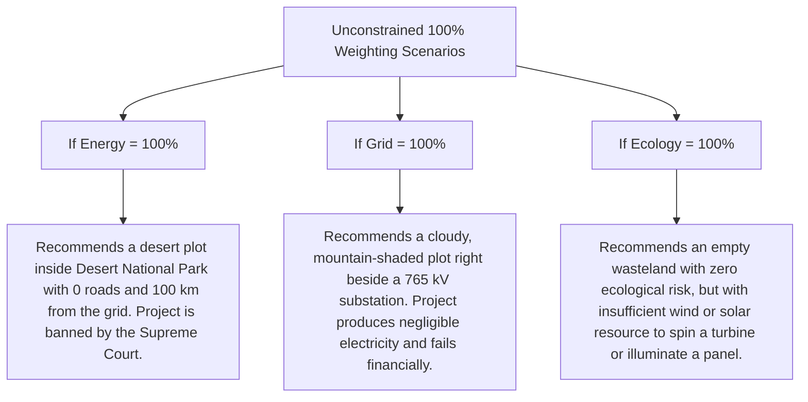

# GreenSelect AI Recommender: Techno-Economic Priority Weights & Slider Limits Explanation

> **Document Type**: Engineering Rationale & Decision Science Reference  
> **Platform**: GreenSelect — AI-Powered Renewable Energy Siting Platform  
> **Target Audience**: Energy Developers, System Architects, Research Reviewers  

---

## 1. Executive Summary: What are the Slider Limits?

In the **GreenSelect AI Site Recommendation Wizard**, developers configure 5 sliders under **"Configure Techno-Economic Priority Weights"**:

| # | Priority Criterion | Minimum | Maximum Cap | Default Value | Rationale Category |
| :-: | :--- | :-: | :-: | :-: | :--- |
| **1** | **Energy Yield Potential** *(Solar GHI / Wind Speed)* | 5% | **60%** | 35% | Primary Physical Generation Driver |
| **2** | **Grid Interconnection Proximity** | 5% | **50%** | 25% | Primary Financial / CAPEX Bottleneck |
| **3** | **Environmental & Ecological Buffer** | 5% | **40%** | 15% | Legal, Regulatory & Wildlife Risk |
| **4** | **Land Cover Siting Suitability** | 5% | **40%** | 15% | Land Acquisition Speed & Social Conflict |
| **5** | **Economic Feasibility & Terrain Slope** | 5% | **30%** | 10% | Secondary Civil Engineering CAPEX |

---

## 2. Core Decision Science Principle: Preventing "Single-Factor Blindness"

In utility-scale civil infrastructure, **no single factor can ever be 100% of the siting decision**.

If any single slider were permitted to reach 100%, developers or automated optimization scripts would encounter catastrophic real-world failure modes:



> **The Multi-Criteria Siting Mandate**:  
> By enforcing bounded ceilings ($60\%, 50\%, 40\%, 40\%, 30\%$), the Multi-Criteria Decision Analysis (MCDA) framework ensures that every recommended candidate site remains **physically productive, legally compliant, and financially buildable**.

---

## 3. Deep-Dive: Why Each Specific Maximum Was Chosen

```
                             HIERARCHY OF MAXIMUM SLIDER BOUNDS
                             
      60% ──► [ 1. Energy Yield Potential ]   (The Natural Fuel of the Project)
      50% ──► [ 2. Grid Interconnection ]     (#1 Transmission CAPEX & Right-of-Way Risk)
      40% ──► [ 3. Environmental Buffer ]     (Gatekeeping Legal / Biodiversity Protection)
      40% ──► [ 4. Land Cover Suitability ]   (Speed of Acquisition & Avoiding Farmer Disputes)
      30% ──► [ 5. Economic & Terrain Slope ] (Secondary Grading & Road Logistics)
```

---

### 3.1 Why Energy Yield Potential is Capped at 60% (The Highest Cap)

* **Physical Nature**: Energy resource quality (Global Horizontal Irradiance $\text{GHI}$ in $\text{kWh/m}^2/\text{day}$ or Wind Speed at 50m in $\text{m/s}$) is the **primary physical driver**. 
* **Economic Justification**: Over the 25-year design lifecycle of a power plant, power generation ($GWh$) directly determines power purchase agreement (PPA) revenues and Levelized Cost of Electricity ($\text{LCOE}$). Without adequate resource, no financial model can service debt.
* **Why Capped at 60%**: Even if maximizing generation is the primary strategy, at least **40% of the decision weight must remain anchored in transmission grid, land legality, and access** to prevent selecting stranded assets in untappable wilderness.

---

### 3.2 Why Grid Interconnection Proximity is Capped at 50% (The Second Highest Cap)

* **Physical Nature**: Geodesic distance to the nearest $400\text{kV}/765\text{kV}$ pooling substation or Inter-State Transmission System (ISTS) node.
* **Economic Justification**: In India, constructing dedicated extra-high-voltage (EHV) transmission bays and lines costs **₹2.0 to ₹4.0 Crore per kilometer**. Building a 30 km dedicated feeder line can add **₹60 to ₹120 Crore** in upfront capital expenditure (CAPEX) and delay commissioning by 24–36 months due to Right-of-Way (RoW) acquisition.
* **Why Capped at 50%**: Highly budget-constrained developers can dedicate up to half their decision weight to grid proximity, but no more—because a free substation connection is useless if the site receives low sunlight or sluggish wind.

---

### 3.3 Why Environmental & Ecological Buffer is Capped at 40%

* **Physical Nature**: Spatial buffer distance to National Parks, Wildlife Sanctuaries, Ramsar Wetlands, and protected avian flyways (such as Supreme Court-mandated Great Indian Bustard priority zones).
* **Economic Justification**: Environmental compliance is a **protective risk-mitigation factor**, not a revenue generator. Siting within eco-sensitive zones triggers litigation, public interest stay orders, or mandatory high-cost underground cabling.
* **Why Capped at 40%**: A 40% ceiling allows strict Environmental, Social, and Governance (ESG) funds to heavily penalize and eliminate high-risk sites. It is capped at 40% because pure ecological safety alone produces zero megawatts.

---

### 3.4 Why Land Cover Siting Suitability is Capped at 40%

* **Physical Nature**: Satellite-derived surface cover based on ESA WorldCover (rewarding barren wastelands, scrubland, and salt flats; penalizing fertile cropland, dense forests, and water bodies).
* **Economic Justification**: Acquiring multi-crop agricultural land triggers social protests, long land acquisition tribunal proceedings, and high land compensation payouts. Degraded state wastelands (e.g., Bhadla, Khavda) offer fast-track 30-year lease execution.
* **Why Capped at 40%**: 40% provides ample weight to prioritize public wastelands, but prevents the system from selecting cheap barren tracts that lack transmission lines or renewable resources.

---

### 3.5 Why Economic Feasibility & Terrain Slope is Capped at 30% (The Lowest Cap)

* **Physical Nature**: Ground slope angle ($\theta^\circ$) from SRTM Digital Elevation Models and shortest distance to National/State Highways.
* **Economic Justification**: Steep ground requires earthmoving excavation, terracing, and custom mounting pile depths. Long distances to paved highways complicate transporting 70-meter wind blades and 150-ton power transformers.
* **Why Capped at 30%**: In practical renewable engineering, **civil engineering and road distance rarely cancel an otherwise world-class solar or wind site**. Grading and access roads represent only $5\% - 10\%$ of total project CAPEX. Therefore, slope and road factors are restricted to a 30% ceiling so they cannot override prime solar resources or high-voltage grid connections.

---

## 4. Mathematical Behavior: What Happens When You Max Out All Sliders?

When a user drags every slider to its maximum ceiling (as in the wizard):

$$\text{Raw Slider Sum} = 60\% + 50\% + 40\% + 40\% + 30\% = 220\%$$

In `backend/app/services/recommendation_service.py`, the backend engine executes continuous **L1 Normalization**:

$$w_i = \frac{p_i}{\sum_{k=1}^5 p_k}$$

### Normalized Execution Table

| Criterion | Raw Slider Value ($p_i$) | Normalization Formula | Effective Normalized Weight ($w_i$) |
| :--- | :---: | :---: | :---: |
| **1. Energy Yield Potential** | $0.60$ (60%) | $\frac{60}{220}$ | **$27.27\%$** |
| **2. Grid Interconnection** | $0.50$ (50%) | $\frac{50}{220}$ | **$22.73\%$** |
| **3. Environmental Buffer** | $0.40$ (40%) | $\frac{40}{220}$ | **$18.18\%$** |
| **4. Land Suitability** | $0.40$ (40%) | $\frac{40}{220}$ | **$18.18\%$** |
| **5. Economic Feasibility & Slope** | $0.30$ (30%) | $\frac{30}{220}$ | **$13.64\%$** |
| **TOTAL** | **$2.20$ (220%)** | — | **$100.00\%$** |

> **Mathematical Guarantee**:  
> Even if all sliders are maxed out, the system automatically scales them back to **$100\%$ total weight** while strictly preserving the **relative importance hierarchy**:  
> $$\text{Energy} (27.3\%) > \text{Grid} (22.7\%) > \text{Eco} (18.2\%) = \text{Land} (18.2\%) > \text{Civil} (13.6\%)$$

---

## 5. Architectural Implementation Reference

* **Frontend Slider Bounds**: [RecommendationWizard.tsx](frontend/src/pages/RecommendationWizard.tsx#L195-L295)  
  *(Defines `<input type="range" min="0.05" max="0.60" ... />` for each criterion).*
* **Backend Normalization & Scoring**: [recommendation_service.py](backend/app/services/recommendation_service.py#L46-L105)  
  *(Applies normalization and computes composite Multi-Criteria Decision scores).*
* **Data Transfer Objects**: [backend/app/schemas/recommendation.py](backend/app/schemas/recommendation.py#L12-L19)  
  *(Validates incoming priority payloads from client requests).*
